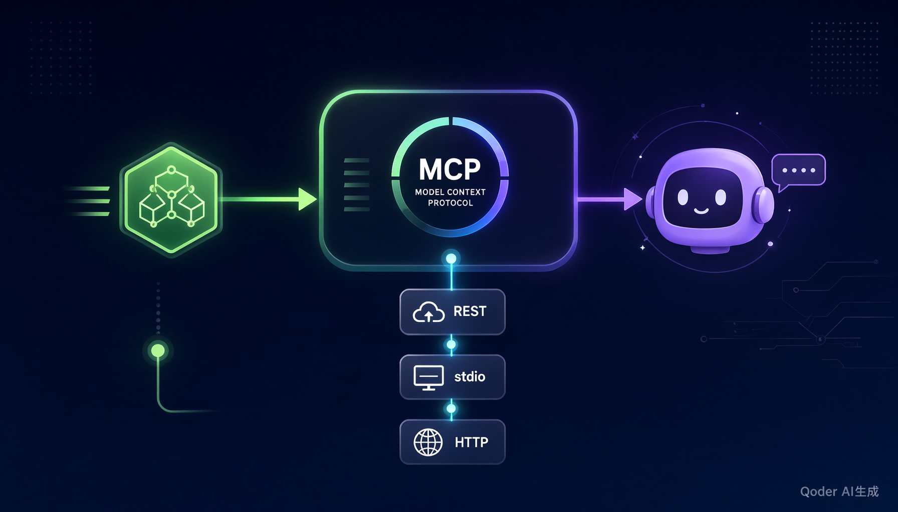

# 我用 Express 写了个 MCP，Claude 直接调用我的 API 了



## 写在前面

作为一个写了多年 Express 的老后端，前阵子被「AI Agent」「MCP」刷屏，心里其实有点慌：这套东西是不是要从头学一套新框架？

动手之后发现——**根本不是**。MCP Server 的宿主还是你熟悉的那套 Node，业务逻辑还是你写的 `service` 函数。你要做的，只是给同一份逻辑再开一个「AI 看得懂」的入口。

这篇用一个能跑的 `express-mcp-starter`，讲清楚怎么让 Claude 直接调用你的接口。全套技术栈：**Express 4 + 官方 `@modelcontextprotocol/sdk` + zod + TypeScript**，没有黑魔法。

## 核心思路：一套 service 三吃

很多人一上来就想「MCP 要怎么单独搭一套服务」，结果写出一份和 REST 完全割裂的重复代码。我的做法是**分层**，把业务逻辑收在中间层，让三个入口共用：

```
src/
  service.ts    # 核心业务，唯一真相来源
  app.ts        # 入口1：Express REST（/api/trending、/api/readme）
  mcp.ts        # 入口2：MCP stdio（给本地 Claude Desktop 用）
  http-mcp.ts   # 入口3：MCP HTTP（POST /mcp，可部署成远端服务）
```

**规则只有一条：不要在 route 或 tool 里写业务逻辑，全部下沉到 `service.ts`。** route 和 tool 只是两种「外壳」。

## 第 1 层：service.ts（业务层）

这是被复用的核心。以「查 GitHub 热门仓库」为例，里面还贴心地做了限频兜底：

```typescript
export interface RepoItem {
  repo: string;
  stars: number;
  desc: string;
  url: string;
}

// 兜底数据：GitHub API 限频时不至于整个工具崩掉
const FALLBACK: RepoItem[] = [
  { repo: "n8n-io/n8n", stars: 98700, desc: "TS工作流自动化", url: "https://github.com/n8n-io/n8n" },
  { repo: "modelcontextprotocol/typescript-sdk", stars: 13600, desc: "MCP官方TS SDK", url: "https://github.com/modelcontextprotocol/typescript-sdk" },
];

export async function getTrending(topic = "typescript", limit = 5): Promise<RepoItem[]> {
  try {
    // 用 GitHub Search API 做真实数据，免 key 但有频率限制 (60次/小时)
    const q = encodeURIComponent(`topic:${topic} language:TypeScript stars:>500`);
    const res = await fetch(`https://api.github.com/search/repositories?q=${q}&sort=stars&order=desc&per_page=${limit}`, {
      headers: {
        "User-Agent": "express-mcp-starter",
        ...(process.env.GITHUB_TOKEN ? { Authorization: `Bearer ${process.env.GITHUB_TOKEN}` } : {}),
      },
    });
    if (!res.ok) throw new Error(`github api ${res.status}`);
    const data: any = await res.json();
    return (data.items || []).slice(0, limit).map((r: any) => ({
      repo: r.full_name,
      stars: r.stargazers_count,
      desc: r.description || "",
      url: r.html_url,
    }));
  } catch (e) {
    console.error("[service] github api failed, use fallback:", (e as Error).message);
    return FALLBACK.slice(0, limit);
  }
}
```

注意这里**调试日志用的是 `console.error` 而不是 `console.log`**——这个坑下面重点讲。

## 第 2 层入口 A：app.ts（你最熟的 REST）

这部分没有任何新知识，就是一个普通 Express。`service` 拿过来直接用：

```typescript
const app = express();
app.use(cors());
app.use(express.json());

app.get("/health", (_req, res) => res.json({ ok: true, time: new Date().toISOString() }));

app.get("/api/trending", async (req, res) => {
  const topic = String(req.query.topic || "typescript");
  const limit = Number(req.query.limit || 5);
  const data = await getTrending(topic, limit);
  res.json({ topic, count: data.length, data });
});
```

跑起来：`npm run dev:api`，浏览器打开 `http://localhost:3000/api/trending?topic=mcp`，能看到数据。这证明 `service` 层是通的。

## 第 3 层入口 B：mcp.ts（让 Claude 能用）

重点来了。MCP stdio 版本给本地 Claude Desktop 用，它**不监听端口**，而是通过标准输入输出和 Claude 通信。你只需要把 `service` 的函数注册成「工具」：

```typescript
import { McpServer } from "@modelcontextprotocol/sdk/server/mcp.js";
import { StdioServerTransport } from "@modelcontextprotocol/sdk/server/stdio.js";
import { z } from "zod";
import { getTrending, getRepoReadme } from "./service.js";

const server = new McpServer({ name: "express-mcp-demo", version: "1.0.0" });

server.registerTool(
  "get-trending",
  {
    description: "获取 GitHub 热门仓库，按 topic 和语言过滤",
    inputSchema: {
      // .describe() 不是可选的装饰，AI 就是靠这句话决定传什么参数
      topic: z.string().optional().describe("关键词，如 typescript, mcp, self-hosted"),
      limit: z.number().min(1).max(10).optional().describe("返回条数，默认5"),
    },
  },
  async ({ topic, limit }) => {
    const data = await getTrending(topic || "typescript", limit || 5);
    return { content: [{ type: "text", text: JSON.stringify(data, null, 2) }] };
  }
);

async function main() {
  const transport = new StdioServerTransport();
  await server.connect(transport);
  console.error("✅ MCP stdio started: express-mcp-demo");
}
main().catch((e) => { console.error(e); process.exit(1); });
```

对比一下 REST 入口：逻辑一模一样，区别只在于——REST 把结果 `res.json(...)`，MCP 把结果塞进 `{ content: [{ type: "text", text }] }`。**这就是所谓的「一套 service 三吃」。**

## 接入 Claude Desktop

编辑配置文件（Mac：`~/Library/Application Support/Claude/claude_desktop_config.json`；Win：`%APPDATA%/Claude/claude_desktop_config.json`）：

```json
{
  "mcpServers": {
    "express-demo": {
      "command": "npx",
      "args": ["tsx", "/你的绝对路径/express-mcp-starter/src/mcp.ts"]
    }
  }
}
```

重启 Claude，直接问：**「调用 get-trending 查下 mcp 热门」**——它就会自己调你这个函数。

> Cursor 同理：Settings → MCP → Add Server，粘贴上面这段。

## 第 4 层入口 C：http-mcp.ts（远端部署）

stdio 版只能给本地 Claude 用。要部署到服务器给别人用，就换成 Streamable HTTP 传输，挂在你熟悉的 Express 上：

```typescript
app.post("/mcp", async (req, res) => {
  const server = new McpServer({ name: "express-mcp-demo-http", version: "1.0.0" });
  server.registerTool("get-trending", { /* 同上 */ }, async ({ topic, limit }) => ({
    content: [{ type: "text", text: JSON.stringify(await getTrending(topic || "typescript", limit || 5), null, 2) }],
  }));

  const transport = new StreamableHTTPServerTransport({ sessionIdGenerator: undefined });
  res.on("close", () => transport.close());   // 记得清理，否则连接泄漏
  await server.connect(transport);
  await transport.handleRequest(req, res, req.body);
});
```

## 怎么验证工具真的注册成功

别靠「感觉」，用官方 SDK 的 Client 连上去 `listTools` 一看便知：

```javascript
// test/verify-register-tool.mjs —— 走 stdio 连 src/mcp.ts
const client = new Client({ name: "verify-client", version: "1.0.0" });
await client.connect(transport);
const { tools } = await client.listTools();
// 断言 get-readme 的 description 和 schema 正确
```

`npm test` 里还有个 REST 冒烟测试，`/health` 和 `/api/trending` 都过了才安心。

## 踩坑清单（血泪，写文章 / 上手都必备）

1. **`package.json` 必须 `"type": "module"`**，否则官方 SDK 的 `import` 路径（`./service.js`）直接报错。
2. **stdio 里绝对不能 `console.log`**，它会污染 JSON-RPC 协议导致 Claude 解析失败——所有调试一律走 `console.error`。
3. **zod 参数一定要写 `.describe()`**，否则 AI 不知道该传什么，工具形同虚设。
4. **GitHub API 免 key 限频 60 次/小时**，在 `.env` 里加 `GITHUB_TOKEN` 能提到 5000 次；同时像 `service.ts` 那样准备一份 `FALLBACK`，别让工具在限频时整个崩掉。

## 小结 & 下一步

回头看，MCP 对 Express 开发者的门槛低得出人意料：

- 业务逻辑还是你熟悉的 `service` 函数；
- 只是多包一层「AI 能读懂」的工具外壳（description + zod schema）；
- 传输层选 stdio（本地）还是 HTTP（远端），取决于你想给谁用。

**一句话：你会写 Express，就已经会写一半 MCP 了。**

下一步计划（也是我第二篇的选题）：把 `http-mcp.ts` 部署到 Render / Sealos，让远端 MCP 也能被调用；再加第三个工具「读 README 做项目解读」。

---

如果你觉得有用，点个收藏；有问题评论区见，我会把仓库和更多 demo 补上。
